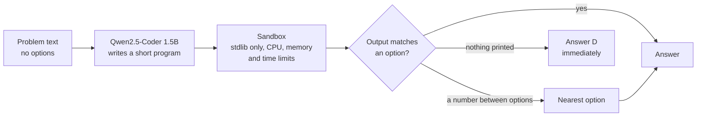

# Math on the Edge: an offline maths copilot on an Arduino UNO Q


-1baf7a)


Our entry for the **Datathon FME 2026 (UPC), Qualcomm main challenge "Math on the Edge"**: solve Kangaroo maths-competition problems (multiple choice A–E, in English and Catalan) with a language model that runs **entirely inside an Arduino UNO Q**. No network, 60 seconds per problem, on a 4-core Cortex-A53 CPU.

| | Practice set (100 rows) |
|---|---|
| Random guess | 20 % |
| Always answer `D` | 20/100 |
| Challenge baseline (one letter, constrained to A–E) | 23/100 |
| **This project**, Qwen2.5-Coder 1.5B writes a program (laptop, full run) | **46/100** |
| This project on the UNO Q, 40-row subset (aggregate record) | 19/40 (47.5 %), 29.8 s mean, 48.0 s worst |

The practice set is 50 problems, each in English and Catalan, so these are not 100 independent observations, and the hidden test is small (about ±10 points of noise). The board figure is an aggregate record only: no per-question CSV and no RAM measurement. Every number, and what is still missing, is in [docs/results.md](docs/results.md).

> **🏆 We also won the Tinybird side challenge** ("Best agentic use of RawTree") at the same datathon, on 15 November 2026, with DevFlight, the platform we used to observe our own AI-assisted development of this project: **[jan-lozano-dev/devflight-rawtree](https://github.com/jan-lozano-dev/devflight-rawtree)**.

## The two parts of the challenge

| The challenge asks for | What we built | Where |
|---|---|---|
| **Reason:** pick the right answer on a hidden test, under 60 s per problem | A small model does not reason in prose. It writes a short **Python program**, a sandbox runs it, and the output is matched to one of the five options | [`predict.py`](predict.py), [`copilot/`](copilot/), [docs/reason.md](docs/reason.md) |
| **Teach:** guide a student without giving the answer | **Cortex**: adaptive practice where the student commits to an answer and a confidence first, static hand-written explanations, and spaced-repetition flashcards. No language model is involved | [`cortex/`](cortex/README.md) |
| Everything offline on the board | `llama-server` and the embedding server run as `systemd` services on the board; the Python that runs there uses only the standard library | [`board/`](board/), [`config.env`](config.env) |
| Use M3Kang in an original way | The model never sees the options when it writes the program, so the program computes the answer instead of guessing a letter; M3Kang also drives the flashcards and the error analysis | [docs/results.md](docs/results.md) |
| Measure it and analyse the errors by topic, language and level | Every run is a CSV, and the analysis is published as aggregate metrics | [docs/results.md](docs/results.md), [docs/evaluation/](docs/evaluation/) |

## How Reason works

A 1.5B model is poor at picking a letter directly: the original baseline scored 65/281 on validation, exactly what answering `D` every time gives. So `predict.py` changes the question.



- The program is generated **without showing the options**. Showing them was worse in both models we tried (29 → 35 and 43 → 47 correct without them).
- The sandbox allows a few standard modules and bans file, network and interpreter access, with CPU, memory and wall-clock limits.
- The time budget is 55 s per problem (`REASON_BUDGET_SECONDS`), under the 60 s limit. Temperature is 0, so the same input gives the same answers.
- When the program matches an option it is right 80.5 % of the time (33/41 in the full laptop run); the fallback path is right 22.0 % of the time (13/59), which is chance.

Details, discarded ideas and how to repeat a measurement: [docs/reason.md](docs/reason.md).

## Run it on your own board

You need an Arduino UNO Q 4 GB prepared as in the [organisers' kit](https://github.com/mpous/datathon-UPC-maths-qualcomm-arduino-unoq), internet for the first install, and the board's `sudo` password.

```bash
git clone https://github.com/jan-lozano-dev/datathon-2026.git
cd datathon-2026

# Run the numbered scripts in order: check the board, install packages, build the
# pinned llama.cpp, download the pinned models, install the services, smoke-test.
./board/00_check_board.sh        # then 01_..., 02_..., 03_..., 04_..., 05_smoke_test.sh

# Answer a test exactly as the challenge runs it
python3 predict.py --input exam.jsonl --output answers.csv
```

[`config.env`](config.env) pins llama.cpp (`2cbe0ec`) and, for each model, its repository, revision, file and SHA256. The input is the challenge's JSONL, with the options as text (see [`data/sample_problems.jsonl`](data/sample_problems.jsonl)). The output is a CSV with `id, language, answer, seconds, status`.

**To get the best result:**

1. Boot the board a couple of minutes early and check the model is loaded: `curl -s 127.0.0.1:8081/health`.
2. `predict.py` warms the model up by itself before the first problem (`REASON_WARMUP=1`, the default): it reads the shared prompt prefix once. That time is not counted against any problem.
3. Run the whole test in **one** call. Splitting it repeats the warm-up.
4. Make sure **nothing else uses the model** during the run. The server has one slot, and a request with a different prompt evicts the cache, so later problems run out of time.
5. Keep the official service settings (context 4096, 4 threads) and the pinned Q4_K_M model.
6. Check the CSV at the end: one letter per problem and every `seconds` below 60.

## Experiments against the baseline

The changes that moved the score, with the sets they were measured on. All laptop figures, no board clock.

| Change | Result |
|---|---|
| Challenge baseline, practice set | 23/100: 16/80 text-only, 7/20 with a figure |
| Program-of-thought with Qwen2.5-Coder 1.5B (variant E10), full run | **46/100**: 40/80 text-only, 6/20 with a figure |
| Own synthetic problems (80 rows): baseline → Coder 1.5B (E11) | 19/80 → 54/80 |
| Original validation baseline (281 M3Kang problems) | 65/281 (23.13 %), same as always `D` |

The synthetic set was used to choose variants, so it is not an independent test.

## Teach: Cortex

[`cortex/`](cortex/) is a local web app, a cut-down [LearnHarness](https://github.com/amosblomqvist/learnharness) (AGPL-3.0).

- **Practice.** It opens on a problem with its statement (formulas in KaTeX) and figure. The student picks a letter and a confidence from 0 to 100 % before submitting. Grading is on the server, so the right letter never reaches the browser early. The next problem adapts.
- **Explain after answering.** A short hand-written solution, shown after the answer. Static text: no model, no cost.
- **Flashcards.** Anki-style decks with FSRS-6 scheduling. The *Kangaroo toolkit* deck has 20 cards on areas, Pythagoras, polygon angles, divisibility, counting, pigeonhole, probability and percentages.
- **Offline.** In a browser check with the network blocked, no request left the machine.

It has been checked on a laptop, not yet on the board. How to run it and what was removed from LearnHarness: [cortex/README.md](cortex/README.md) and [cortex/DEMO_SCOPE.md](cortex/DEMO_SCOPE.md).

## Repository

```
├── predict.py, eval.py       Reason entry point and evaluation
├── copilot/                  pipeline, program generation, sandbox, option matching
├── cortex/                   Teach web app
├── board/, config.env        board setup: pinned llama.cpp and models, systemd services
├── laptop/, explorer/        data preparation (OCR of the options) and a problem explorer
├── benchmark/, experiments/  reproducible evaluation harness and the experiments
├── tests/                    unit tests for Reason
├── docs/                     reports and plans (index: docs/README.md)
└── agents/                   instructions, skills and prompts for AI agents
```

Quick start on a laptop (Python 3.10+):

```bash
python3 -m venv .venv && .venv/bin/pip install -r laptop/requirements.txt
.venv/bin/python laptop/prepare_m3kang.py --save-images      # M3Kang → data/train.jsonl, data/val.jsonl
python3 predict.py --input data/sample_problems.jsonl --output results/check.csv
python3 eval.py --limit 200 --name my-change                 # needs llama-server on port 8081
```

## Documentation

| | |
|---|---|
| [docs/reason.md](docs/reason.md) | How Reason works, what was tried and discarded, how to repeat a measurement |
| [docs/results.md](docs/results.md) | Accuracy, latency and error analysis, with the figures that can and cannot be backed |
| [docs/baseline-audit.md](docs/baseline-audit.md) | Audit of the original baseline |
| [docs/experiment-plan.md](docs/experiment-plan.md) | Experiments proposed after the audit |
| [docs/README.md](docs/README.md) | Full index |
| [agents/README.md](agents/README.md) | The material given to AI agents, and how to enable it in Claude Code |

## Data and license

- **Code:** [MIT](LICENSE). The exception is [`cortex/`](cortex/), which derives from LearnHarness and is licensed under AGPL-3.0 (see [cortex/LICENSE](cortex/LICENSE)).
- **M3Kang** is licensed for research use only. Nothing under `data/` is committed except `data/sample_problems.jsonl` (made-up problems for smoke tests). Images, `.env` files and the private `results/` stay out of Git. See [data/README.md](data/README.md). Dataset card: [qualcomm/M3Kang](https://huggingface.co/datasets/qualcomm/M3Kang); paper: Torres-Camps et al., 2026, [arXiv:2601.16218](https://arxiv.org/abs/2601.16218).

## Credits

Built on the organisers' kit ([mpous/datathon-UPC-maths-qualcomm-arduino-unoq](https://github.com/mpous/datathon-UPC-maths-qualcomm-arduino-unoq)) and the [M3Kang](https://arxiv.org/abs/2601.16218) dataset. Qualcomm challenge, Datathon FME 2026 (UPC). The Tinybird side challenge, which we won, lives in [devflight-rawtree](https://github.com/jan-lozano-dev/devflight-rawtree).
